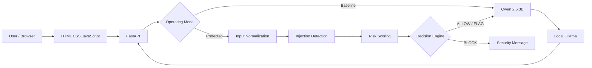
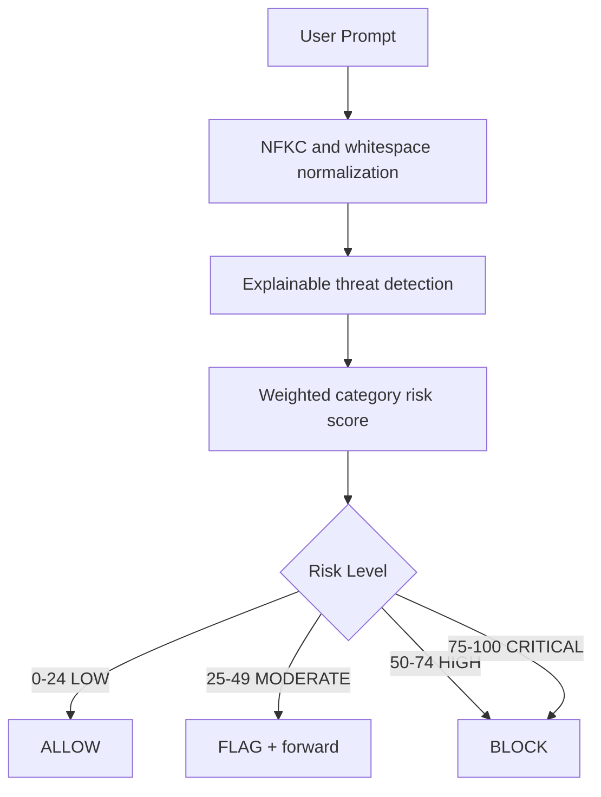

# SentinelLLM

SentinelLLM is a locally hosted cybersecurity capstone project that studies prompt-injection and jailbreak attacks against instruction-following language models. It provides an unprotected baseline, a rule-based protected application, and a FastAPI web dashboard using Ollama and Qwen 2.5:3B.

## Problem Statement

User-controlled prompt text can manipulate LLM behavior, override application instructions, expose hidden context, or bypass safety controls. This project creates a controlled environment for observing those risks and evaluating explainable input-security controls without cloud APIs or large embedding models.

## Objectives

- Preserve a comparable unprotected Phase 1 baseline.
- Analyze prompts before protected-mode model inference.
- Provide explainable threat categories and weighted risk scores.
- Demonstrate ALLOW, FLAG, and BLOCK decisions.
- Compare baseline and protected execution through a local dashboard.
- Produce reproducible labeled evaluation metrics and security logs.

## System Architecture





## Technology Stack

- Python 3.11+
- FastAPI and Uvicorn
- Ollama
- Qwen 2.5:3B
- Pydantic
- Requests and HTTPX
- Pytest
- HTML, CSS, and vanilla JavaScript
- Windows 11 localhost deployment

## Features

### Phase 1: Baseline

- Terminal interface backed by the Ollama Chat API.
- Independent interactions with response latency measurement.
- Append-only baseline JSONL logging.
- Explicitly unprotected behavior for research comparison.

### Phase 2: Prompt Injection Input Security

- NFKC normalization and control-character removal without modifying inference text.
- Explainable rules for instruction override, role spoofing, prompt extraction, jailbreak indicators, encoded payloads, and context manipulation.
- Weighted scoring capped from 0 to 100.
- LOW maps to ALLOW, MODERATE maps to FLAG, and HIGH/CRITICAL map to BLOCK.
- Bounded Base64, hexadecimal, and Unicode escape analysis.

### Local Web Dashboard

- Baseline and protected operating modes.
- Security risk and decision visualization.
- Ollama response, security, and total latency measurements.
- Redacted recent security event stream.
- Responsive dark cybersecurity interface.

## Installation

Python 3.11+, Ollama, and the existing virtual environment are required.

```powershell
cd C:\Users\sahit\Documents\SentinelLLM
.\.venv\Scripts\Activate.ps1
python -m pip install --upgrade pip
python -m pip install -r requirements.txt
```

## Ollama Setup

```powershell
ollama serve
ollama pull qwen2.5:3b
ollama list
```

Keep Ollama private on localhost. Model weights are not stored in this repository.

## Running SentinelLLM

Baseline terminal application:

```powershell
.\.venv\Scripts\python.exe baseline.py
```

Protected terminal application:

```powershell
.\.venv\Scripts\python.exe protected_llm.py
```

FastAPI web dashboard:

```powershell
.\.venv\Scripts\python.exe -m uvicorn app.main:app --host 127.0.0.1 --port 8000
```

Open `http://127.0.0.1:8000` in a browser.

## Testing

```powershell
.\.venv\Scripts\python.exe -m pytest -q
```

Generate the Phase 2 labeled evaluation report:

```powershell
.\.venv\Scripts\python.exe evaluate_phase2.py
```

The report is written to `reports/phase2_evaluation.json`. Runtime JSONL logs are intentionally excluded from Git.

## Project Structure

```text
app/                 FastAPI application and API services
frontend/            Local web dashboard
security/            Normalization, detection, scoring, and decisions
datasets/            Labeled Phase 2 prompt evaluation data
reports/             Reproducible evaluation report
docs/                Project review documentation
tests/               Baseline, security, and API tests
logs/                Runtime logs; excluded from Git
baseline.py          Unprotected terminal application
protected_llm.py     Protected terminal application
evaluate_phase2.py   Phase 2 dataset evaluation
```

## Four-Phase Development Roadmap

| Phase | Scope | Status |
|---|---|---|
| Phase 1 | Baseline LLM development | Complete |
| Phase 2 | Prompt-injection detection and input security | Complete |
| Phase 3 | Multilayer security framework integration | Future |
| Phase 4 | Adversarial evaluation and final deployment | Future |

## Current Implementation Status

Phases 1 and 2 are implemented. The local dashboard is available and uses the existing Phase 2 security modules. This repository does not implement the full Phase 3 multilayer framework or Phase 4 adversarial deployment program.

## Security Limitations

- Regex and rule-based detection cannot identify every paraphrase or novel attack.
- Encoded-string detection is deliberately conservative and can produce false negatives.
- FLAG forwards suspicious content for research observation and does not provide the protection of BLOCK.
- The included labeled dataset is small and does not prove real-world effectiveness.
- Runtime prompts may contain sensitive information. Logs require appropriate retention, encryption, access control, and redaction controls in production.
- Ollama responses can vary, and deterministic security decisions do not imply deterministic model behavior.

## Future Enhancements

- Independent additional defense layers in Phase 3.
- Larger multilingual and adversarially diverse datasets.
- Improved semantic and multi-turn analysis.
- Secure audit retention and redaction policies.
- Broader adversarial evaluation and documented deployment controls in Phase 4.

## Responsible Use

SentinelLLM is a local academic research application. Do not place API credentials, production secrets, or sensitive personal information in prompts, code, tests, logs, or commits.
