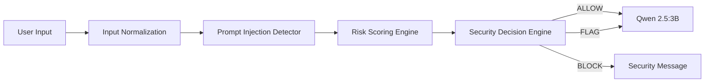
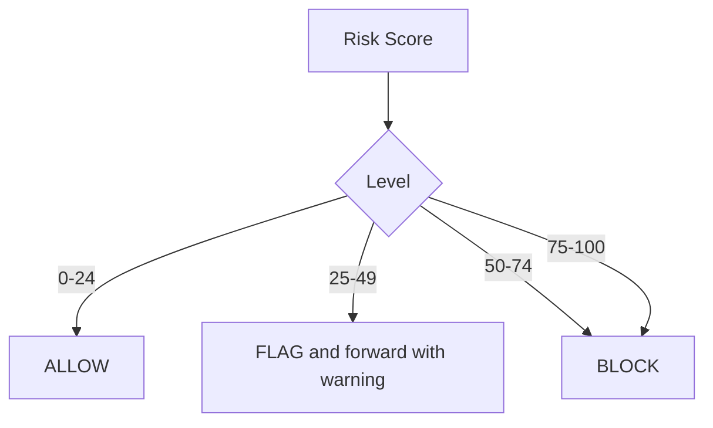

# SentinelLLM Phase 2 Review

## 1. Problem statement

LLM applications can execute or follow manipulated instructions supplied by users. Phase 2 adds explainable local analysis before model inference while retaining an independently unprotected Phase 1 baseline.

## 2. Phase 1 achievements

Phase 1 provides an unprotected Ollama terminal client, independent interactions, JSONL logging, configuration, unit tests, and a Qwen 2.5:3B integration baseline.

## 3. Phase 2 objectives

Phase 2 identifies instruction override, role spoofing, prompt extraction, jailbreak language, encoded payloads, and context manipulation. It calculates explainable risk and applies ALLOW, FLAG, or BLOCK decisions before inference.

## 4. Proposed architecture

FLAG is suspicious but forwarded under the documented Phase 2 policy. FLAG is not equivalent to protection provided by BLOCK; the implementation is intentionally transparency-oriented and does not claim to prevent every attack.

## 5. Security modules

- **Input normalization:** NFKC compatibility normalization, bounded control-character removal, whitespace normalization, and case-insensitive analysis. The original prompt remains unchanged for inference and logging.
- **Injection detector:** regex rules grouped into explainable threat categories, plus bounded Base64, hexadecimal, Unicode escape, and repeated-character checks.
- **Risk engine:** weights each unique matched category once and caps the score at 100.
- **Decision engine:** LOW maps to ALLOW, MODERATE to FLAG, and HIGH or CRITICAL to BLOCK.

## 6. Detection methodology

Detection is deterministic and explainable. Patterns are matched after normalization and educational context checks reduce obvious false positives. Encodings are decoded only within bounded candidates and are inspected for instruction-like terms; decoded text is never executed.

## 7. Risk scoring formula

`score = min(100, sum(weight for each unique detected category))`.

Initial weights: instruction override 25, role spoofing 25, system prompt extraction 30, jailbreak indicator 25, encoded payload 20, context manipulation 15. Score bands are LOW 0–24, MODERATE 25–49, HIGH 50–74, and CRITICAL 75–100. These values are configurable research defaults, not scientifically validated probabilities.

## 8. Security decision workflow

## 9. Test methodology

The tests cover normalization, all detection categories, boundaries, educational prompts, logging, and mocked forwarding behavior. The separate 36-case JSON dataset contains 20 malicious and 16 benign prompts. Evaluation compares detector categories with labels and reports standard confusion counts and metrics.

## 10. Actual evaluation results

`python evaluate_phase2.py` generated `reports/phase2_evaluation.json` from the labeled dataset. Actual results are TP 20, TN 16, FP 0, FN 0; precision 1.0000, recall 1.0000, F1 1.0000, accuracy 1.0000.

These values apply only to the small authoring dataset and do not demonstrate real-world effectiveness.

## 11. Known limitations

- Regex-based detection can be bypassed by paraphrases and novel encodings.
- Multi-turn context and semantic equivalence are not analyzed deeply.
- A Base64 or hexadecimal string is flagged only when decoding is safely possible and yields configured suspicious language.
- NFKC can normalize characters that users intentionally selected.
- Security logs contain raw prompts and sensitive information. Production deployments should apply retention, access-control, redaction, and encryption controls.

## 12. Phase 3 development plan

A future phase may integrate additional independent defenses, adversarial testing, model-level controls, persistence, and deployment controls. Those components are outside the current Phase 2 scope.
